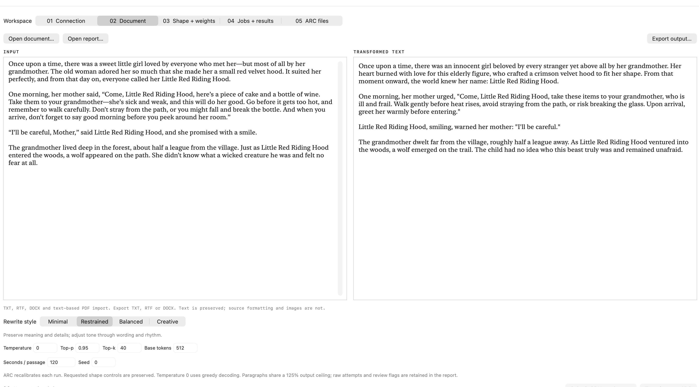
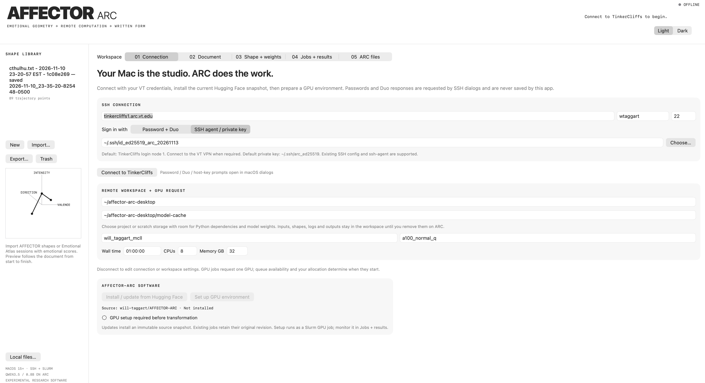
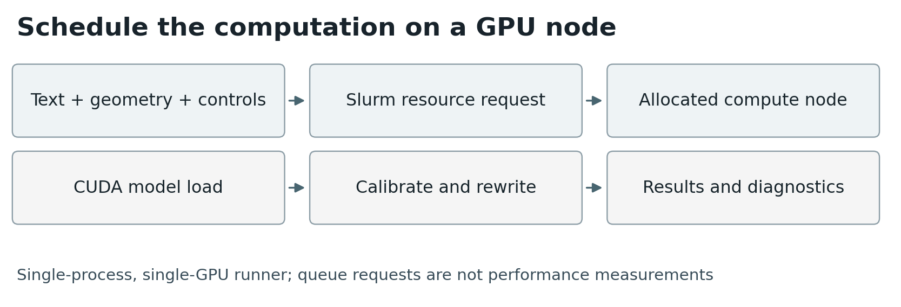
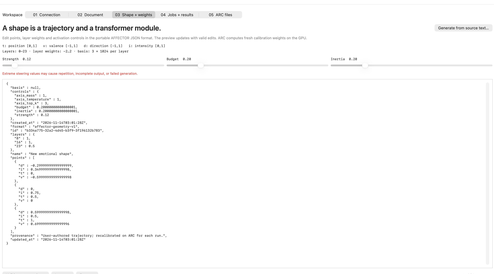

# AFFECTOR-ARC: Emotional Trajectory Control through Transformer Activation Steering

**William Taggart**  
Modern and Classical Languages and Literatures, Virginia Tech  
Email: wtaggart@vt.edu  
**Technical report · November 14, 2026 · Revision 0.3**

## Abstract

AFFECTOR-ARC is an experimental text-rewriting system with a native macOS application and a command-line CUDA runner. The desktop application manages documents, emotional geometries, SSH connections, Slurm GPU jobs, and downloaded results; the runner executes a frozen Qwen3.5-0.8B model on an allocated ARC GPU. A trajectory specifies valence, inward/outward emotional orientation, and intensity across normalized document position. Contrasting English passages establish three activation directions at each selected transformer layer. During generation, trajectory coordinates determine a displacement scaled to the hidden-state magnitude, smoothed across decoding steps, and constrained by an RMS budget. Paired hooks apply it to the feed-forward input and residual path. Four editing styles, sentence-aware segmentation, bounded generation, and incremental reports make the intervention available within a document workflow. This report describes both interfaces and derives the steering mechanism, while distinguishing implementation checks from evidence of emotional effectiveness. Earlier desktop GPU runs and CPU policy tests are documented separately; they do not validate every subsequent runner revision or establish emotional accuracy, semantic preservation, or multilingual effectiveness.

## Purpose and Research Context

AFFECTOR-ARC investigates whether a writer can guide the emotional progression of a document by specifying a trajectory and intervening in a language model's internal computation. The practical aim is to make that experiment usable across a complete rewrite: the writer selects a text, supplies an emotional geometry, adjusts the intervention, and inspects the resulting passages and diagnostics. A native macOS application brings these activities into a workspace, while SSH and Slurm connect that workspace to a GPU allocation on Virginia Tech ARC. A command-line runner exposes the computation separately for scripted experiments and reproducible execution.

The geometry gives this workflow a common representation. It is an ordered path through valence, inward/outward emotional orientation, and intensity, accompanied by layer settings and optional calibration matrices. Sampling the path at successive document positions supplies the coordinates used during rewriting. Those coordinates become displacements of the model's hidden states, so the desired progression acts on the computation that produces tokens rather than prescribing particular words. The model's stored parameters remain fixed throughout.

This mechanism builds on contrastive activation steering. Turner and colleagues derive directions from contrasting prompts, and Panickssery and colleagues average differences between positive and negative behavioral examples ([Turner et al., 2023](https://arxiv.org/abs/2308.10248v1); [Panickssery et al., 2024](https://arxiv.org/abs/2312.06681v4)). AFFECTOR-ARC applies the same broad principle to small sets of emotionally contrasting passages, then mixes the resulting directions according to the requested trajectory. The central research question is how reliably this mapping can influence a sustained rewrite, given that a numerical displacement need not produce a unique or consistent emotional interpretation.



*Figure 1. Document workspace displaying an existing Little Red Riding Hood input and rewrite.*

That question connects the implementation to research on the relation between model representations and human judgments. Wu and colleagues study concept-based emotional steering across linguistic-cultural settings, while Diallo and colleagues use human ratings to examine perceived emotional intensity and text quality ([Wu et al., 2025](https://arxiv.org/abs/2506.13978v1); [Diallo et al., 2026](https://arxiv.org/abs/2601.21505v1)). These studies motivate coordinate-based experiments whose outcomes are judged through readers' interpretations. They do not, however, establish the validity of this system's inward/outward axis or calibrate its RMS-scaled controls. The requested trajectory, the activation displacement, and the emotion perceived in the output must therefore be evaluated as related but distinct quantities.

The reliability of that relationship also depends on where and how the intervention is applied. Shu and colleagues find uneven causal organization across emotion categories, and Wang and colleagues show that strong probing accuracy need not identify the most effective intervention layers ([Shu et al., 2026](https://arxiv.org/abs/2604.25866v3); [Wang et al., 2026](https://arxiv.org/abs/2609.22135v1)). Ha and colleagues' finding that supportive-empathy directions are only partially separable further cautions against treating emotional axes as independent controls ([Ha et al., 2026](https://arxiv.org/abs/2609.15654v1)). Automated vector extraction and context-dependent strength offer approaches to these calibration problems ([Cui et al., 2025](https://arxiv.org/abs/2509.22739v3); [Ferrando et al., 2025](https://arxiv.org/abs/2512.03661v2)). AFFECTOR-ARC makes layer weights and axis mixtures explicit so that such questions can be investigated, although its current runner uses user-selected settings rather than an adaptive emotional-feedback controller.

Applying those settings across a document makes generation stability part of the same problem. E-STEER reports non-monotonic effects of emotional interventions, and Jeong observes both emotional changes and degeneration in small models ([Sun et al., 2026](https://arxiv.org/abs/2604.00005v1); [Jeong, 2026](https://arxiv.org/abs/2604.04064v1)). A stronger displacement can thus disrupt a rewrite without bringing it closer to the intended trajectory. The system addresses the operational consequences through bounded generation, repetition checks, passage-level failure records, and a desktop workflow for reviewing jobs and results. These safeguards preserve an inspectable experiment; they do not establish that a completed rewrite meets its emotional target.

Evaluation must consequently consider emotional alignment together with fluency, content change, and failure rates. SteerScope examines efficacy, side effects, generalization, and dependence on steering data, finding no general advantage over prompt steering in its tested trade-offs ([Yang et al., 2026](https://arxiv.org/abs/2610.07722v1)). For AFFECTOR-ARC, this motivates comparisons with prompt-only and unsteered rewriting, blinded emotional and quality ratings, and complete reporting of retained originals, repetition, and truncation. The scope of this report is the desktop-to-cluster workflow and the implemented steering procedure, including their engineering checks. Establishing emotional effectiveness and a reliable operating range remains an empirical task.

## Runtime and data flow

### Native macOS client and remote execution

The native SwiftUI application is distributed on Hugging Face for Apple Silicon Macs running macOS 15 or later. Its connection workspace configures SSH access and the Slurm resource request. The document workspace holds the input and generated text; the shape and weights workspace supports importing, converting, and editing geometries and intervention settings. Jobs and results controls expose remote progress, diagnostics, and output downloads. The application also manages Hugging Face source updates and submits GPU-environment setup through Slurm.

The Mac serves as the client: lightweight SSH requests manage files and jobs, while model setup and execution run in requested GPU allocations. The bundled Python remote agent handles requests over SSH without a persistent listening server. The desktop interface and the command-line runner are separately versioned components, so a recorded application version alone does not identify the remote engine revision. Both should be recorded when reporting a run.

### CUDA runner

The runner loads `Qwen/Qwen3.5-0.8B` at revision `2fc06364715b967f1860aea9cf38778875588b17`. The implementation uses `Qwen3_5ForConditionalGeneration`, its text decoder layers, float32 computation, eager attention, and the first process-visible CUDA device. It checks for 24 decoder layers; the geometry and calibration code assume hidden width 1,024. The backbone is in evaluation mode, its parameters have gradients disabled, and calibration and generation run without gradient tracking.



*Figure 2. Connection workspace with SSH settings and the Slurm GPU resource request. The client is offline in this capture.*
The execution sequence is:

```text
Read text and geometry settings
    → validate controls
    → load the pinned model on CUDA
    → calibrate the selected layers
    → select rewrite or smoke mode
    → generate with temporary activation hooks
    → remove hooks and save results
```

Source files are distributed with the repository. `ENGINE_MANIFEST.json` records hashes for the bundled engine snapshot. Model weights are downloaded separately. The setup script creates a Python 3.12 environment, installs PyTorch from the CUDA 12.6 wheel index, pins Transformers to 5.22.2, runs the CPU policy tests, and records installed packages in `environment-resolved.txt`. PyTorch and several support packages are resolved during setup rather than fully locked in advance.

The example Slurm script requests one GPU, eight CPU cores, 64 GB of host memory, and one hour. These are scheduling requests, not measured minimum requirements. Users must supply an allocation and a suitable model cache. The runner is single-process and single-GPU; it is not a concurrent inference server.



*Figure 3. Execution schematic. The compute workload belongs to the allocated GPU node. Resource requests describe scheduling needs and do not establish measured minimum requirements.*

## Emotional coordinates and trajectory interpolation

A trajectory point is

$$
p_j=(t_j,v_j,d_j,i_j),
$$

where positions $t_j$ increase strictly within $[0,1]$. Valence $v_j$ ranges from negative to positive in $[-1,1]$. Direction $d_j$ ranges from inward-oriented to outward-oriented emotion in $[-1,1]$. Intensity $i_j$ ranges from low to high in $[0,1]$. Direction is an operational contrast concerning emotional orientation; it is not dominance, speaker identification, or positive versus negative sentiment.

Between adjacent points, the software linearly interpolates each emotional coordinate. Before the first point and after the last, it uses the endpoint values. The coefficient vector passed to the activation module is

$$
c(t)=\bigl(v(t),d(t),2i(t)-1\bigr).
$$

Consequently, intensity 0.5 contributes a zero intensity coefficient; intensity zero contributes a negative coefficient. These are control conventions, not empirically established psychological units.

For a chunk occupying character offsets $[a,b)$ in an input of length $N$, its target is evaluated at

$$
t=\frac{a+b}{2N}.
$$

That target remains constant throughout generation of the chunk. A long trajectory can therefore guide a short document without pairing source and target paragraphs one to one. Only the positions sampled by the target chunks are used; narrow changes between those positions may be missed. The mapping uses original input positions, not positions in the expanding or contracting output. Adjacent chunks receive separate generation calls without prior rewritten chunks as conversational context.

The runner accepts a native geometry JSON file and supported analysis JSON structures containing emotional coordinates. It recalibrates the basis on the current CUDA runtime even when the imported geometry includes one. With no geometry argument, it uses a demonstration path with three points; this path is not inferred from the input document.

## Estimating activation directions

A hidden state at a selected layer is a vector in $\mathbb{R}^{1024}$. To estimate a direction associated with one emotional contrast, the system compares the model's states for paired passages that differ in the desired property.

There are four hand-authored English pairs for each of three axes. For layer $\ell$, axis $j$, and pair $k$, let $h_{\ell,j,k}^{+}$ and $h_{\ell,j,k}^{-}$ denote the captured states for the two members. The mean difference is

$$
u_{\ell,j}=\frac14\sum_{k=1}^{4}
\left(h_{\ell,j,k}^{+}-h_{\ell,j,k}^{-}\right).
$$

For a vector of dimension $D$, define root-mean-square magnitude as

$$
\mathrm{RMS}(x)=\sqrt{\frac1D\sum_{r=1}^{D}x_r^2}.
$$

The normalized direction is

$$
b_{\ell,j}=\frac{u_{\ell,j}}
{\max(\mathrm{RMS}(u_{\ell,j}),10^{-8})}.
$$

The three directions form the rows of a matrix $B_\ell\in\mathbb{R}^{3\times1024}$. Calibration captures the final chat-formatted prompt position immediately before `post_attention_layernorm`. It does not average all token positions. All selected layers are captured during the same 24 forward passes: three axes, four pairs, and two members per pair.

Default layers are 8, 16, and 23, using zero-based indexing, with weights 1, 1, and 0.5. This is subtraction, averaging, and normalization; there is no training optimizer, backbone fine-tuning, orthogonalization, or outcome-based fitting. The small calibration set may encode vocabulary, topic, or perspective along with emotion. Normalizing the vectors does not establish that the axes are independent or valid across languages.

## From coordinates to bounded displacements

### Selecting and weighting axes



*Figure 4. Geometry and weights editor with the trajectory and activation-steering controls.*
Let $T$ be axis temperature. Each coordinate first receives magnitude

$$
q_j=|c_j|^{1/T}.
$$

Axes are sorted by this magnitude. The algorithm retains at most `axis_top_k` axes and stops adding axes after their accumulated magnitude reaches `axis_mass` times the total magnitude. Selection includes the axis that crosses the threshold. The retained coefficients are

$$
a_j=\mathrm{sign}(c_j)q_jm_j,
$$

where $m_j$ is one for a retained axis and zero otherwise. Coefficients are not renormalized after selection. For coordinate magnitudes below one, $T<1$ reduces their magnitudes and emphasizes relative differences; $T>1$ increases them and makes those differences less pronounced. These operations affect three activation coefficients, not token probabilities.

### Strength, inertia, and budget

For the current final-token state $h_{\ell,n}$, strength $s$, and layer weight $w_\ell$, the raw displacement is

$$
r_{\ell,n}=s\,w_\ell\mathrm{RMS}(h_{\ell,n})(aB_\ell).
$$

Multiplication by the current state's RMS expresses the intervention relative to the layer's numerical scale. A negative layer weight reverses the mixed direction at that layer.

On the first decoding step, the smoothed displacement equals $r_{\ell,n}$. On later steps, inertia $\rho$ combines the previous applied displacement with the new raw displacement:

$$
\widetilde\delta_{\ell,n}=\rho\delta_{\ell,n-1}+(1-\rho)r_{\ell,n}.
$$

Budget $\beta$ then limits the RMS ratio:

$$
\delta_{\ell,n}=\widetilde\delta_{\ell,n}
\min\left(1,
\frac{\beta\mathrm{RMS}(h_{\ell,n})}
{\max(\mathrm{RMS}(\widetilde\delta_{\ell,n}),10^{-12})}
\right).
$$

Strength determines the proposed displacement; budget supplies its ceiling. Raising the budget has no effect when the proposed displacement already fits below it. Budget 1 permits a displacement as large in RMS as the hidden state itself. It is not a token allowance, a semantic-change quota, or a guarantee of stronger emotional accuracy. Inertia uses the previous already-capped displacement and resets with each new generation call.

### Intervention site

Let $h$ denote the state entering the feed-forward portion of a decoder block. Without intervention, that portion computes

$$
y=h+\mathrm{FFN}(\mathrm{Norm}(h)).
$$

The implemented intervention produces

$$
y=(h+\delta)+\mathrm{FFN}(\mathrm{Norm}(h+\delta)).
$$

A pre-hook adds $\delta$ to the normalization input; a block-output hook adds the same displacement to the residual result. Adding a vector only after an unchanged feed-forward computation would have a different effect. Only the final prompt position is modified during prefill; cached decoding modifies the current generated position. The module does not wait for specific words or phrases. Generation hooks are removed in a `finally` block.

This is an open-loop intervention. Coefficients come from the requested absolute coordinates, not the difference between a measured output emotion and the target. A zero coefficient adds no intervention on that axis; it does not actively neutralize emotion already expressed by the model.

## User controls and rewrite instructions

| Control | Default without an imported override | Function |
|---|---:|---|
| Strength | 0.12 | Scale the proposed activation displacement |
| Budget | 0.20 | Cap displacement RMS relative to hidden-state RMS |
| Inertia | 0.20 | Weight the preceding applied displacement |
| Axis top-k | 3 | Maximum number of retained emotional axes |
| Axis mass | 1.0 | Cumulative magnitude threshold for axis selection |
| Axis temperature | 1.0 | Exponent control for emotional-axis magnitudes |
| Temperature | 0 | Select greedy decoding or token sampling |
| Top-p | 0.95 | Probability-mass cutoff when sampling |
| Top-k | 40 | Token candidate count when sampling |
| Base output tokens | 512 | Initial generation allowance, expanded in rewrite mode |
| Time limit | 120 seconds | Per-generation stopping threshold |

The CLI overrides only the activation settings explicitly supplied; other settings come from the imported geometry or defaults. Validation permits strength 0–2, budget 0–1, inertia 0–0.99, axis top-k 1–3, axis mass 0.01–1, and axis temperature 0.1–3. These accepted ranges are not validated operating recommendations. The terminal displays the warning: **Extreme values for strength, budget, and inertia may cause generation failures.**

At temperature zero, decoding is greedy and top-p/top-k are inactive. At positive temperature, they affect token selection after the model computes its scores. They do not replace or modify the three-axis activation selection mechanism.

Four system-prompt styles provide separate editing constraints:

- **Minimal:** change a few words or phrases while preserving nearly all wording and sentence order.
- **Restrained:** adjust tone through wording, rhythm, and emphasis while preserving central meaning, facts, terminology, and structure; invent no scenes or metaphors.
- **Balanced:** allow a clearer emotional shift and modest figurative language while retaining central meaning, facts, people, and events.
- **Creative:** permit changes to meaning, imagery, and events, while requesting concise output in the same language.

Restrained is the default in rewrite mode. Smoke mode retains its original general rewriting instruction unless a style is explicitly selected. Each prompt requests complete sentences and treats supplied text as material rather than instructions. A per-chunk suffix specifies the original character count and hard character allowance. Numerical emotional coordinates are not inserted into these prompts; the coordinates act through hidden states. Prompt instructions influence generation but are not formal semantic guarantees. The runner has no semantic-equivalence rejection filter and does not lower steering settings automatically.

## Segmentation, length control, and repetition

The runner reads and trims the outer whitespace of a UTF-8 text file. Blank lines define paragraphs. Long paragraphs are split using a 700-character ceiling, preferring sentence punctuation when a suitable boundary exists, then whitespace, and finally a hard split. This is a punctuation heuristic, not a linguistic sentence parser. Original whitespace between chunks is preserved during output assembly.

Within each original paragraph, the character ceiling is 125% of the original span processed so far. If $s$ is the first chunk's start, $b_j$ the current chunk's end, and $U_j$ the output characters and intervening whitespace already used, the current allowance is

$$
L_j=\max\left(0,\left\lfloor1.25(b_j-s)\right\rfloor-U_j\right).
$$

Unused allowance carries forward within that paragraph. It cannot be borrowed from future chunks or transferred across a blank-line paragraph boundary. Character counts are Python string lengths, not word counts, encoded byte counts, or model-token counts.

Generation aims for the original length. Starting at 85% of the current input chunk's characters, a recognized sentence ending can stop generation. A separate hard character threshold prevents excessive expansion. The token allowance is

$$
K_j=\min\left(2048,\max(K_{\mathrm{base}},L_j)\right),
$$

which supplies decoding headroom but does not imply one token equals one character. The time threshold is checked between decoding steps and cannot interrupt a blocked GPU kernel immediately.

Decoding also uses a repetition penalty of 1.1 and an eight-token no-repeat n-gram constraint. A text-level detector checks every eight generation steps for repeated three- to six-word sequences appearing at least four times in the last 100 words, or a short compact character pattern repeated at least six times in the last 240 characters. These heuristics can miss some loops and can flag intentional repetition.

After a generation attempt, the runner checks for repetition, empty output, excessive length, and an unfinished ending. A problematic draft is reduced to a complete, nonrepetitive sentence prefix within its allowance. If none exists, the original chunk is retained and flagged. The returned draft remains in the report's attempt record before sentence salvage. However, the engine has already clipped it to the hard character allowance; the report is not a lossless record of characters beyond that boundary.

Sentence cleanup prevents chopped words from being joined directly to the next passage, but it may omit ideas from the tail of a draft. Neither punctuation recognition nor output-size compliance establishes completeness of meaning.

## Failure handling and output artifacts

Each chunk receives one generation attempt at the requested activation settings. A caught generation exception is recorded; the original chunk remains in the assembled text and processing continues. Calibration failures, invalid inputs, filesystem failures, and process termination are outside this per-chunk recovery mechanism and can stop a run. A persistent device failure may cause subsequent chunks to fail as well.


*Figure 5. Jobs and results controls in the offline client; the report pane has no loaded report.*
After each processed chunk, the runner writes:

1. An atomic JSON report containing the input, geometry, calibration basis, runtime identity, style, sampling settings, character spans, target coordinates, and per-chunk records.
2. A matching plain-text file containing completed rewrites plus original text at unprocessed or retained positions.

Successful generation records include stopping reason, token count, elapsed time, activation-injection count, and mean displacement RMS. Attempt records retain returned drafts, effective controls, detected issues, and exceptions where applicable. At normal completion the report adds failure and review counts. `complete` means every chunk was processed, not that every chunk was successfully rewritten or emotionally accurate.

JSON writes use temporary-file replacement. The companion text file is written normally and may be incomplete if interrupted during that write. Reports are incremental records, not automatic resume checkpoints: rerunning starts over and overwrites the selected output paths. Use a distinct output filename for each experiment. Reports contain the input text and should be treated as document-bearing artifacts.

The desktop document view is a presentation layer over these artifacts. The published client displays generated passages separately from source text and diagnostics; its text exports can therefore differ from the runner's assembled file, which includes retained originals. The downloadable report is needed to distinguish generated, retained, failed, and unprocessed passages. Reconnecting can recover an existing job and its outputs, but this client recovery does not make the runner's incremental report a resumable generation checkpoint.

## Engineering checks and evidence

Smoke mode is the default and operates on one supplied passage. It runs baseline, zero-strength, positive-valence, negative-valence, and restored-baseline conditions. Positive and negative conditions use coefficient vectors $(0.8,0,0)$ and $(-0.8,0,0)$. The third coordinate zero corresponds to intensity 0.5.

With greedy decoding, the checks require zero-strength and baseline decoded text/token counts to match, nonzero injections in the positive and negative cases, restored hook counts, restored baseline text/token counts, and disabled backbone gradients. Positive and negative outputs need not differ for these checks to pass. Settings that suppress all effective intervention are unsuitable for the nonzero-injection checks.

Smoke mode defaults to the original 128-token allowance and 600-second time threshold. Its original instruction permits changes in phrasing, imagery, and emotional expression while preserving the passage’s main subject and recognizable situation. It omits the new repetition penalty, n-gram guard, and document-length salvage so that existing commands retain their original generation configuration and compare raw generations. It saves completed conditions incrementally and marks `checks_complete` only after assertions pass. It does not compare logits, full token sequences, parameter hashes, or independently measured per-step RMS bounds. Run with ordinary Python rather than assertion-disabling optimization flags.

For the November 13 revision, seven CPU policy tests passed, Python and shell syntax were checked, and CLI loading was verified. Tests cover such behavior as unchanged requested controls, paragraph allowance accounting, draft retention, sentence cleanup, and continuing after a failed chunk. They do not execute the CUDA model. The current revision has not yet been run on an ARC GPU. A successful GPU run was reported for an earlier revision on November 12; it is historical evidence, not validation of the current code.

The desktop release also has its own validation record. Its published version 1.0.4 documentation reports native Swift tests, 14 remote-agent tests, a completed sample rewrite, and an earlier GPU setup on an NVIDIA A100-SXM4-80GB. These are release-specific engineering observations, not measurements of emotional accuracy or validation of later changes to the remote runner. The screenshots show the native application's workspaces, including offline states where indicated.

## Reproduction

For the desktop workflow, download the native macOS application from the repository's macos directory on Hugging Face, unpack it, and open AFFECTOR ARC.app. Configure the connection profile for the user's own ARC login, SSH authentication, and Slurm allocation. After connecting, install or update the remote source and prepare the GPU environment as needed. Import a document and geometry, adjust the settings, and choose Transform on ARC. Monitor the submitted job in Jobs + results and download its input, output, report, geometry, and logs. The published desktop README identifies the application as version 1.0.4 and describes its build as ad-hoc signed.

The following commands provide the separate command-line workflow. They run inside a suitable ARC GPU allocation from a fresh repository copy:

```bash
bash setup.sh
source "$(conda info --base)/etc/profile.d/conda.sh"
conda activate "$PWD/.conda"
python run_arc.py --mode smoke --text-file passage.txt \
  --output runs/smoke.json
```

Setup expects a fresh `.conda` destination. A populated model cache or permitted download route is required. Existing compatible environments can execute the updated source directly.

To rewrite a document:

```bash
python run_arc.py --mode rewrite --text-file target.txt \
  --geometry shape.json --style Restrained \
  --strength 0.47 --budget 0.47 --inertia 0.2 \
  --temperature 0 --top-p 0.95 --top-k 40 \
  --output runs/rewrite.json
```

These strength and budget values illustrate explicit configuration; they are not an experimentally established optimum. Omitting `--geometry` selects the demonstration trajectory. Batch smoke execution uses `sbatch --account=YOUR_ALLOCATION smoke.sbatch`; the allocation and partition must suit the user's cluster access.

Archive the repository revision, engine manifest, resolved dependencies, GPU and driver information, command-line arguments, input, geometry, and report. The engine identity's `source_commit` field currently contains a snapshot label rather than a Git commit hash, so the repository revision should be recorded separately. The default seed is zero and TF32 matrix multiplication is disabled, but identical results across hardware and library versions are not guaranteed.

## Scientific limits and evaluation requirements

The system offers a direct, inspectable intervention, not a demonstrated emotional matching algorithm. Its main limitations are the small English calibration set, untested interactions between axes and layers, open-loop use of absolute targets, and lack of independent output assessment. The model can change subject matter or factual claims, especially under Creative instructions or strong perturbations. Stronger displacement can degrade fluency without improving emotional alignment.

A proper evaluation should distinguish emotional movement from target accuracy. Collect independent ratings of input and output along operationally defined axes, compare requested and observed trajectories, and report failures and unmodified fallbacks alongside successful generations. Include unsteered rewriting, prompt-only emotional instructions, opposite targets, random directions of matched magnitude, and layer/axis ablations. Keep decoding settings fixed for controlled comparisons, and separate greedy from sampled experiments.

Semantic fidelity should be evaluated against the selected style: Creative permits mutation, whereas Restrained requests factual preservation. Fluency, coherence across chunks, omitted material, repetition, length ratios, latency, and memory consumption are separate outcomes. No automatic similarity score, feedback optimization, or acceptance threshold is implemented in this runner.

Changing to a larger model requires new architecture validation, basis calibration, layer selection, and operating-range experiments. A basis with three rows and 1,024 columns cannot simply be reused with a different hidden width or intervention site. Multilingual operation likewise requires independent calibration and evaluation; same-language prompt wording alone does not establish it.

## Implementation sources

This report covers the native macOS client, its SSH request agent, and the CUDA runner. The desktop release and its source are available alongside the remote engine:

- [Native macOS application, Swift source, and release documentation](https://huggingface.co/will-taggart/AFFECTOR-ARC/tree/main/macos)
- [CUDA runner and smoke protocol](https://huggingface.co/will-taggart/AFFECTOR-ARC/blob/main/run_arc.py)
- [Document transformation and incremental output](https://huggingface.co/will-taggart/AFFECTOR-ARC/blob/main/document_run.py)
- [Calibration, displacement math, hooks, and decoding](https://huggingface.co/will-taggart/AFFECTOR-ARC/blob/main/engine/steering.py)
- [Geometry schema and interpolation](https://huggingface.co/will-taggart/AFFECTOR-ARC/blob/main/engine/geometry.py)
- [Segmentation and character allowance](https://huggingface.co/will-taggart/AFFECTOR-ARC/blob/main/engine/documents.py)
- [Rewrite system prompts](https://huggingface.co/will-taggart/AFFECTOR-ARC/blob/main/engine/rewrite_policy.py)
- [Repetition detection and draft salvage](https://huggingface.co/will-taggart/AFFECTOR-ARC/blob/main/engine/generation.py)
- [Engine source hashes](https://huggingface.co/will-taggart/AFFECTOR-ARC/blob/main/ENGINE_MANIFEST.json)
- [Generation policy tests](https://huggingface.co/will-taggart/AFFECTOR-ARC/blob/main/tests/test_generation.py) and [document-run tests](https://huggingface.co/will-taggart/AFFECTOR-ARC/blob/main/tests/test_document_run.py)

## AI assistance disclosure

This project was created with assistance from GPT-6 Astra and Codex. AI tools supported software development, testing, and the drafting and revision of this technical report. William Taggart is responsible for the project's research decisions and the final software and documentation. AI assistance does not constitute independent validation of the implementation or its scientific claims; the validation evidence and limitations are stated separately in this report.

## Research references

Version-specific arXiv records are linked below. Years distinguish original release from later revision where applicable. These research references supplement the implementation and infrastructure sources elsewhere in this report. Reusable citations: [BibTeX](references.bib). Verification details: [source-check notes](LITERATURE_SOURCES.md).

1. Alex Turner; Lisa Thiergart; David Udell; Gavin Leech; Ulisse Mini; Monte MacDiarmid. 2023. Activation Addition: Steering Language Models Without Optimization. [arXiv:2308.10248v1](https://arxiv.org/abs/2308.10248v1). Cited version dated 2023-08-20.

2. Nina Panickssery; Nick Gabrieli; Julian Schulz; Meg Tong; Evan Hubinger; Alexander Matt Turner. 2024. Steering Llama 2 via Contrastive Activation Addition. [arXiv:2312.06681v4](https://arxiv.org/abs/2312.06681v4). Cited version dated 2024-07-05.

3. Xiuwen Wu; Hao Wang; Zhiang Yan; Xiaohan Tang; Pengfei Xu; Wai-Ting Siok; Ping Li; Jia-Hong Gao; Bingjiang Lyu; Lang Qin. 2025. AI shares emotion with humans across languages and cultures. [arXiv:2506.13978v1](https://arxiv.org/abs/2506.13978v1). Cited version dated 2025-06-11.

4. Diaoulé Diallo; Katharina Dworatzyk; Sophie Jentzsch; Peer Schütt; Sabine Theis; Tobias Hecking. 2026. The Effectiveness of Style Vectors for Steering Large Language Models: A Human Evaluation. [arXiv:2601.21505v1](https://arxiv.org/abs/2601.21505v1). Cited version dated 2026-01-29. ArXiv record lists IEEE Access 13 (2025), 191443-191457; DOI: 10.1109/ACCESS.2025.3628500.

5. Moran Sun; Tianlin Li; Yuwei Zheng; Zhenhong Zhou; Aishan Liu; Xianglong Liu; Yang Liu. 2026. How Emotion Shapes the Behavior of LLMs and Agents: A Mechanistic Study. [arXiv:2604.00005v1](https://arxiv.org/abs/2604.00005v1). Cited version dated 2026-03-09.

6. Jihoon Jeong. 2026. Extracting and Steering Emotion Representations in Small Language Models: A Methodological Comparison. [arXiv:2604.04064v1](https://arxiv.org/abs/2604.04064v1). Cited version dated 2026-04-05.

7. Bangzhao Shu; Arinjay Singh; Mai ElSherief. 2026. Why Are Some Emotions Harder for LLMs? Uncovering the Causal Mechanisms of Emotion Inference via Sparse Autoencoders. [arXiv:2604.25866v3](https://arxiv.org/abs/2604.25866v3). Cited version dated 2026-10-24.

8. Yibo Wang; Jisheng Dang; Bimei Wang; Yitao Wu; Wencan Zhang; Hong Peng; Jizhao Liu; Bin Hu; Qi Tian; Tat-Seng Chua. 2026. Read-Best Is Not Steer-Best: A Probing--Steering Layer Dissociation in Omni-Modal Large Language Models. [arXiv:2609.22135v1](https://arxiv.org/abs/2609.22135v1). Cited version dated 2026-08-24.

9. JuHeon Ha; Byounghan Lee; Yunseo Choi; Kyung-Ah Sohn. 2026. Empathy Is Steerable but Multi-Axial: Mechanism Geometry and Persona Effects in LLMs. [arXiv:2609.15654v1](https://arxiv.org/abs/2609.15654v1). Cited version dated 2026-09-14. ArXiv comments report acceptance to the EMNLP 2026 main conference.

10. Sasha Cui; Zhongren Chen. 2025. Painless Activation Steering: An Automated, Lightweight Approach for Post-Training Large Language Models. [arXiv:2509.22739v3](https://arxiv.org/abs/2509.22739v3). Cited version dated 2026-05-15.

11. Alex Ferrando; Xavier Suau; Jordi Gonzàlez; Pau Rodriguez. 2025. Dynamically Scaled Activation Steering. [arXiv:2512.03661v2](https://arxiv.org/abs/2512.03661v2). Cited version dated 2026-07-30.

12. Haotian Yang; Huikang Jiang; Yucheng Wu; Wen-Jie Jiang; Chenpeng Wang; Yibin Lou; Liangming Pan. 2026. Does Steering Break Your Model? A Multi-Dimensional Evaluation Suite for LLM Steering Methods. [arXiv:2610.07722v1](https://arxiv.org/abs/2610.07722v1). Cited version dated 2026-10-06.

### Suggested citation

```bibtex
@techreport{taggart2026affectorarc,
  author = {Taggart, William},
  title = {{AFFECTOR-ARC}: Emotional Trajectory Control through Transformer Activation Steering},
  institution = {Modern and Classical Languages and Literatures, Virginia Tech},
  year = {2026},
  month = nov,
  note = {Technical report, revision 0.2; current CUDA and emotional-effectiveness validation pending},
  url = {https://huggingface.co/will-taggart/AFFECTOR-ARC/blob/main/TECHNICAL_REPORT.md}
}
```
