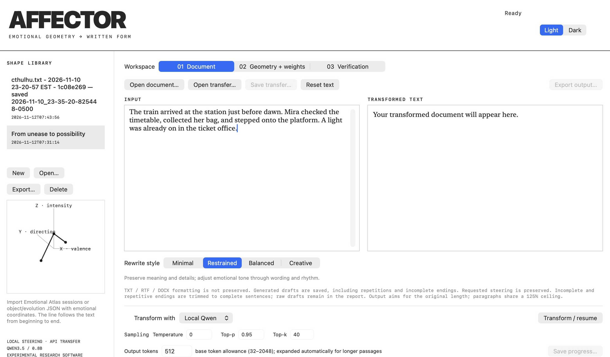
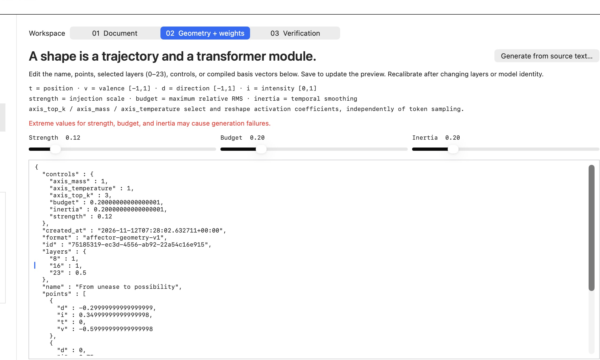
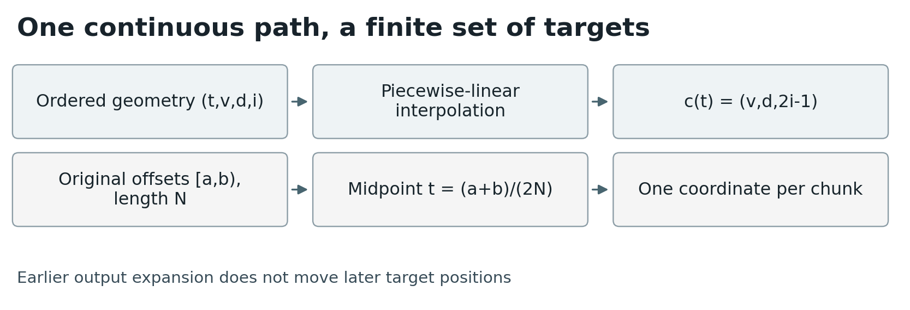
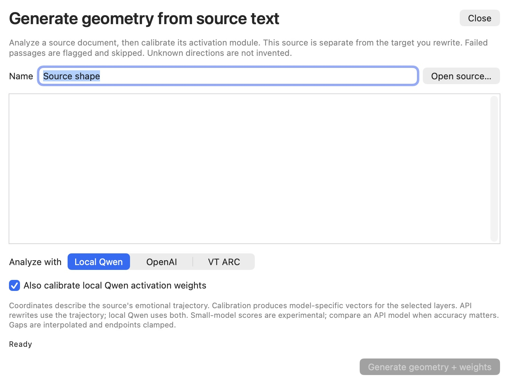
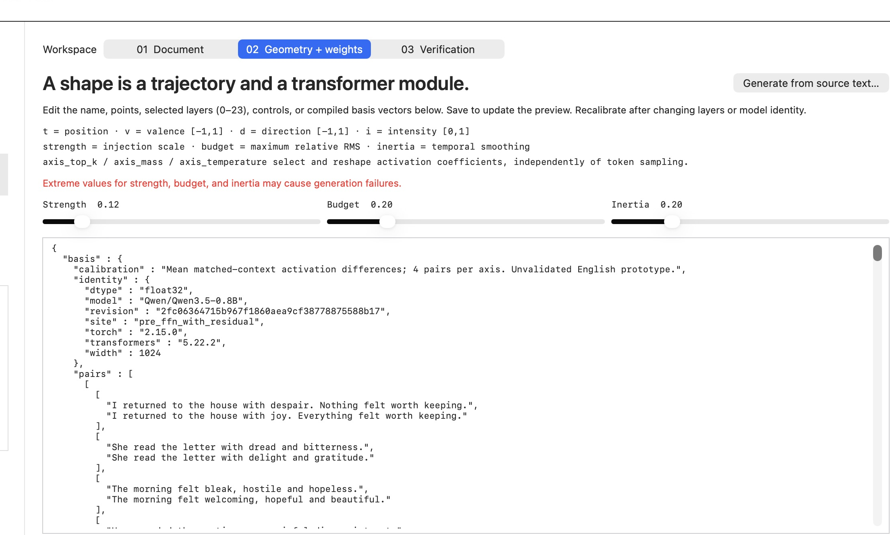

# AFFECTOR: Coordinate-Guided Text Rewriting through Transformer Activation Interventions

**Technical paper:** [PDF](AFFECTOR.pdf) · [LaTeX source](AFFECTOR.tex) · [Complete source ZIP](Source.zip)

**William Taggart**  
Modern and Classical Languages and Literatures, Virginia Tech  
Email: wtaggart@vt.edu  
November 14, 2026 · Implementation report · Desktop version 0.1.0

## Abstract

AFFECTOR investigates whether a prescribed emotional trajectory can influence the rewriting of a document. A trajectory assigns valence, emotional direction, and intensity to normalized positions in a text. A local backend maps these coordinates into perturbations of a frozen language model's internal states, while hosted backends use coordinate-bearing instructions. The desktop application supports geometry authoring, editable numerical steering matrices, document conversion, checkpointing, and separate emotional verification. This paper derives the implemented method from first principles and distinguishes mechanical correctness from successful emotional transfer. Current controls can produce emotionally charged language but can also produce weak paraphrases, factual distortions, and repetition. The implementation is an experimental instrument, not a validated predictor or controller of human emotion.

## Purpose and Research Context

A document conveys more than propositions. Its lexical choices, rhythm, imagery, focus, and narrative stance also shape how a reader feels as the text unfolds. AFFECTOR begins with a practical question about that progression: can a writer specify a desired emotional path and use it to guide a rewrite, while choosing how much of the original content to preserve? To make this question tractable, the application represents the path as an ordered curve of valence, inward/outward emotional direction, and intensity across the document. This representation supplies a coarse target for experimentation, leaving the model to realize it in language. The resulting text must therefore be judged both by its emotional fit and by its readability, content changes, and length.

Activation steering offers a way to connect this target to the process of generation. Turner and colleagues construct intervention vectors from contrasting prompts, while Panickssery and colleagues average activation differences across positive and negative behavioral examples ([Turner et al., 2023](https://arxiv.org/abs/2308.10248v1); [Panickssery et al., 2024](https://arxiv.org/abs/2312.06681v4)). Building on this contrastive approach, AFFECTOR maps emotional coordinates into changes to a frozen model's internal states during local inference. The application also provides an API route, in which the coordinates are expressed as instructions to a hosted model. Together, these routes make it possible to investigate numerical intervention alongside prompt-based control, although their settings and outcomes are not directly interchangeable.

*Figure 1. Document workspace with an example input, rewrite controls, and an empty output pane before generation.*

For either route, the usefulness of the coordinates depends on their relationship to human interpretations of the output. Work by Wu and colleagues connects model emotion spaces with human valence/arousal ratings and reports concept-based steering across linguistic-cultural settings ([Wu et al., 2025](https://arxiv.org/abs/2506.13978v1)). Diallo and colleagues extend this evaluative perspective by examining emotional intensity and text quality with human raters, finding effects that vary with the emotion and steering strength ([Diallo et al., 2026](https://arxiv.org/abs/2601.21505v1)). These findings motivate assessing emotional movement and readable expression separately. They also clarify what remains to be established for AFFECTOR: neither its inward/outward axis nor the correspondence between its RMS-scaled controls and a reader's emotional judgment has been validated by those studies.

This uncertainty concerns the intervention itself as well as its evaluation. Shu and colleagues find uneven causal organization across emotion categories in a study of sparse features and emotion recognition, while Wang and colleagues show that strong emotion-probing accuracy need not identify the best intervention layers in omni-modal models ([Shu et al., 2026](https://arxiv.org/abs/2604.25866v3); [Wang et al., 2026](https://arxiv.org/abs/2609.22135v1)). Thus, recognizing an emotion in a representation does not by itself determine where to intervene to change it. The partially coupled supportive-empathy directions reported by Ha and colleagues further raise the question of whether changing one emotional dimension also moves another ([Ha et al., 2026](https://arxiv.org/abs/2609.15654v1)). Research on automated vector extraction and context-dependent strength offers ways to investigate these problems, with benefits that depend on the task and intended trade-off ([Cui et al., 2025](https://arxiv.org/abs/2509.22739v3); [Ferrando et al., 2025](https://arxiv.org/abs/2512.03661v2)). AFFECTOR exposes layer choices and coordinate mixtures as experimental controls; testing their interactions and potential adaptation remains part of the research agenda.

When these interventions are applied throughout a document, their effects must also be considered over the course of generation. E-STEER reports non-monotonic relationships between emotional interventions and outcomes in reasoning, generation, safety, and agent behavior ([Sun et al., 2026](https://arxiv.org/abs/2604.00005v1)). Similarly, Jeong's small-model comparison finds both coherent emotional changes and degeneration, including repetition, depending on the architecture and extraction method ([Jeong, 2026](https://arxiv.org/abs/2604.04064v1)). These results explain why greater intervention strength cannot simply be equated with a closer emotional match. In response to this practical difficulty, AFFECTOR combines bounded generation with records of repetition, truncation, and failed attempts. Its rewrite styles also let the user state how much content preservation should constrain the transformation, making that trade-off explicit when reviewing an output.

Taken together, these considerations define the scope of the present report: the implemented transformation pipeline, the choices it exposes, and the limits visible in its operation. Emotional verification is a separate user-invoked step; the application does not automatically score each passage and iteratively minimize its distance from the target. A broader assessment must therefore compare the requested progression with independently judged outcomes. SteerScope provides a useful framework by evaluating efficacy alongside side effects, generalization, and dependence on steering data ([Yang et al., 2026](https://arxiv.org/abs/2610.07722v1)). Its finding that activation methods do not dominate prompt steering in the tested trade-offs supports including prompt-only and unsteered baselines, blinded emotional and quality ratings, and complete failure accounting. Such comparisons would establish whether AFFECTOR's controls offer a reliable advantage for particular writing tasks; they remain research requirements rather than completed evidence of effectiveness.

## Representation and alignment

A geometry consists of ordered points `(t, v, d, i)`. Position `t` is in `[0,1]`; valence `v` and direction `d` are in `[-1,1]`; intensity `i` is in `[0,1]`. Negative valence denotes unpleasant affect and positive valence pleasant affect. Negative direction denotes self-focused or inward-directed emotion; positive direction denotes outward focus. Direction is independent of valence: anger toward oneself can be inward and sadness for another person outward. Intensity describes strength of affect, not pleasantness.

*Figure 2. Geometry editor showing the selected three-point trajectory and its steering controls.*
For intervention, intensity is centered:

`c(t) = (v(t), d(t), 2i(t) - 1)`.

Coordinates are linearly interpolated between points, with endpoint clamping outside the stored range. Geometry imports that lack a supported direction omit that point; interpolating across the resulting gap can smooth away meaningful transitions. The imported data's provenance records incomplete coverage.

The target document is divided into chunks of at most 700 characters, preferring sentence endings and then whitespace. Blank-line paragraph boundaries, including whitespace-only blank lines, are recognized. If a chunk spans original character offsets `a` through `b` in an input of length `N`, its target position is `(a+b)/(2N)`. This is computed from the original document, so expansion of earlier output does not move later targets. A single coordinate is applied throughout a chunk. Neighboring chunks are generated independently without surrounding text as generation context.

This normalized alignment compresses or stretches a source trajectory to the target length. It samples only as many positions as there are chunks. It does not preserve all events or oscillations of a much longer curve. Changes to segmentation can change emotional targets even when the same geometry is selected.

*Figure 3. Normalized alignment schematic. Target chunks sample a continuous source path at original character midpoints; a short target can miss narrow changes in a long source trajectory.*

## Frozen model and contrastive calibration

The local backend loads Qwen3.5-0.8B at revision `2fc06364715b967f1860aea9cf38778875588b17`. The implementation operates on its text stack of 24 blocks with hidden width 1,024. Base parameters are frozen; inference uses float32 and eager attention. Apple MPS is selected when available, otherwise CPU. The chat template disables thinking output. The package contains Python 3.14, PyTorch 2.15.0 and Transformers 5.22.2; exact dependency pins accompany the bundle.

*Figure 4. Source-analysis dialog for generating a geometry and optionally calibrating a local activation basis.*
Before steering, the application obtains three directions per selected layer from twelve manually authored English contrast pairs, four per axis. For example, valence pairs contrast despair with joy, and intensity pairs contrast mild unease with overwhelming terror. Both members of every pair are processed under a continuation instruction. Thus calibration requires 24 forward passes.

The capture site is the final chat-formatted prompt position immediately before the post-attention normalization that feeds the feed-forward sublayer. It is not a mean over all content tokens. For layer `l` and axis `j`, the mean contrast is:

`u[l,j] = (1/4) sum_k (h_plus[l,j,k] - h_minus[l,j,k])`.

With `RMS(x) = sqrt(mean_r(x[r]^2))`, normalization gives:

`B[l,j] = u[l,j] / max(RMS(u[l,j]), 1e-8)`.

The resulting `B[l]` is a 3 by 1,024 matrix. These are the editable steering-module weights. Defaults select layers 8, 16, and 23, with weights 1, 1, and 0.5. Geometry files retain the calibration examples, matrices, and model/runtime identity; incompatible identities are rejected.

There is no gradient training, score-supervised fitting, orthogonalization, or guarantee that the three directions isolate their intended concepts. Small hand-authored pairs can confound affect with genre, topic, lexical content, and emotional categories. Calibration is exploratory and English-based; multilingual effectiveness has not been established.

## Coordinate-to-activation computation

Axis temperature `T` transforms each coordinate magnitude while retaining its sign:

*Figure 5. Expanded numerical weights for the selected geometry, including the local calibration metadata.*
`q[j] = sign(c[j]) * abs(c[j])^(1/T)`.

The implementation ranks axes by magnitude, retains at most axis top-k, and stops adding axes once cumulative magnitude reaches the configured mass fraction. Surviving coefficients are not renormalized. These operations act on three emotional coefficients, not on the model's vocabulary distribution.

For current final-token hidden state `h`, strength `s`, and layer weight `w[l]`, the proposed perturbation is:

`delta_raw = (q @ B[l]) * RMS(h) * s * w[l]`.

Inertia `rho` combines this proposal with the previous applied perturbation within the same chunk:

`delta_mix = rho * delta_previous + (1-rho) * delta_raw`.

The first step uses the raw proposal directly. A relative RMS budget `beta` then bounds the perturbation:

`delta = delta_mix * min(1, beta * RMS(h) / max(RMS(delta_mix), 1e-12))`.

Zero strength, budget, or layer weight gives an exact zero perturbation. Each chunk resets inertia history. The settings are applied as requested; the release does not automatically lower them after poor output.

Budget is not a semantic-change percentage. At budget 1, the perturbation can have RMS magnitude comparable to the original hidden state at that site. Large values can destabilize generation. Raising the budget only matters when the proposed perturbation would otherwise be clipped; it cannot correct an inaccurate direction.

## Intervention within the transformer

Let `h` denote a block's residual state after its attention or sequence-mixing stage. A conventional feed-forward residual update has the form:

`y = h + FFN(Norm(h))`.

AFFECTOR implements:

`y = (h + delta) + FFN(Norm(h + delta))`.

A pre-hook on the feed-forward normalization adds `delta` to its input, and a post-hook on the block output adds the same `delta` to the residual branch. This is a forward-pass intervention, not a model-parameter update. Hooks affect only the final token in the initial prompt pass and the current token during cached decoding. They are removed when generation exits, including exceptional exits.

The module does not search for trigger phrases or recognize an idiom before activating. The chosen target determines the intervention continuously during decoding. Nevertheless, generation remains conditional on the input and instruction, and the hidden state influences perturbation magnitude. The module is not a content-independent guarantee of a particular affect.

A key limitation is that the intervention is an absolute-coordinate bias, not a measured error correction. A target valence of zero yields no direct valence-axis perturbation; it does not actively neutralize an already negative passage. Correlations between basis vectors further complicate interpretation.

## Prompts, sampling, and bounded output

Four rewrite styles constrain the instruction: Minimal preserves nearly all wording; Restrained asks for subtle emotional phrasing changes while preserving facts and structure; Balanced allows structural changes and modest imagery while preserving events; Creative permits changes to meaning, imagery, and events. The prompt preferences do not enforce semantic fidelity.

Local prompts do not include the numerical emotional coordinates. Hosted prompts do, because hosted model hidden states are not accessible through the implemented APIs. Consequently, local and API modes are not controlled comparisons of model size alone.

Temperature, top-p, and top-k govern token selection. At temperature zero, decoding is greedy and top-p/top-k are inactive. Positive temperature enables sampling. A repetition penalty of 1.1 and no-repeat 8-gram constraint operate on token decoding; they are distinct from activation steering and cannot guarantee freedom from repetition.

The current output policy uses a shared paragraph allowance equal to 125% of original character length. Unused allowance carries forward to later chunks in the same paragraph; original intervening whitespace counts against it. Earlier chunks cannot borrow from future chunks. Local generation seeks a sentence ending after 85% of the current original chunk length. A hard character ceiling, token ceiling, and 120-second limit remain. Token allowances may expand above the displayed base allowance, up to 2,048 locally and 4,096 for hosted requests.

Repetition detection inspects recent word n-grams and repeated character patterns. If a draft is repetitive, oversized, or unfinished, the output can retain only its complete, non-repetitive sentence prefix, with a warning. If no such prefix exists, the original is retained with an error. One generation attempt is made per chunk; returned drafts, effective controls, stop reasons, and selection information remain in reports. API calls are non-streaming, so their remote generation cannot be stopped at an exact character threshold.

These mechanisms trade completeness for bounded readable output. Sentence punctuation is a heuristic and can misidentify abbreviations or unusual writing. Trimming can omit important content and alter emotional character. They are safeguards against specific generation failures, not a proof of success.

## Independent verification

Verification assesses original and revised chunks separately with an unsteered evaluator or an API model. The evaluator is instructed to distinguish felt or conveyed emotion from mere emotion-word occurrence, identify experiencers and emotional targets, and supply exact quoted evidence. It returns valence, direction, intensity, emotional labels, uncertainty, and concise explanations. Scores are interpretive estimates, not psychometric measurements.

For assessed coordinate `p=(v,d,2i-1)` and target `c`, the reported similarity is:

`similarity = 1 - ||p-c||_2 / (2 sqrt(3))`.

The denominator is the maximum distance across the three-dimensional `[-1,1]` cube. Similarity is not a probability. Axis errors are also reported. Unknown direction makes the three-axis distance unavailable. Aggregate before/after comparisons use only paired valid assessments and report coverage and failures. Missing assessments are not assigned invented scores.

The same small model can assess its own output, but shared weaknesses make independent evaluation preferable. A high similarity can coexist with incoherence, factual errors, or undesirable content. The implementation does not optimize this score during generation and does not include a formal semantic-fidelity metric.

## Architecture, persistence, and privacy

A native SwiftUI/AppKit interface communicates with a Python subprocess through JSON lines; no listening local web server is needed. The desktop app provides geometry management, document transformation, verification, light/dark appearance, and numeric weight editing. TXT, RTF, and DOCX handling preserves textual content rather than rich layout.

Atomic checkpoint writes store original input, offsets, geometry, controls, output records, and verification. Run signatures include the input, settings, geometry, style, and policy version so changed settings do not silently resume incompatible work. Loading an older checkpoint validates its stored spans instead of resegmenting it. Individual generation or assessment failures are flagged without interrupting the whole document. Explicit cancellation stops the run; an in-flight API call can take until its timeout to return.

API keys are held in memory. Local mode processes text on the computer; API mode sends relevant passages to the selected service. Checkpoints contain potentially sensitive document text and should be treated accordingly. The distributed package excludes personal checkpoints and test documents.

## Evidence and limitations

The release's 26 automated tests cover behaviors including checkpoint handling, style persistence, failure continuation, allowance accounting, raw-draft retention, and preservation of requested controls. Earlier development smoke checks established nonzero activation interventions, zero-strength equivalence under greedy decoding, hook cleanup, and the RMS budget bound. These checks establish implementation properties, not emotional efficacy.

Exploratory development runs revealed three important failure modes: high intervention magnitudes can produce repetition before any full sentence; lower magnitudes can yield fluent but weakly emotional paraphrases; and segmentation changes alter which positions of a trajectory are sampled. A temporary whole-paragraph/reduced-steering recovery design improved completion on a small example but weakened the desired affect, and is not the current release behavior.

No representative benchmark, blinded human study, multilingual evaluation, or statistically supported success rate is claimed. Controlled experiments should hold input, geometry, prompt, segmentation, and sampling constant while comparing unsteered and steered output. Report emotional distance, completion rate, repetition, length ratio, factual/content preservation, and human judgments together. Selection based on emotional distance alone can reward extreme or incoherent writing.

## Conclusion

AFFECTOR makes a low-dimensional emotional trajectory operational through explicit transformer-state interventions and a separate prompt-based backend. Its value is as an inspectable experimental system: coordinates, editable vectors, controls, raw drafts, and verification are exposed. Reliable emotional transfer remains an empirical research problem. The current method demonstrates a controllable intervention mechanism but does not establish that a particular intervention reliably creates a specified emotional experience.

## AI assistance disclosure

This project was created with assistance from GPT-6 Astra and Codex. AI tools supported software development, testing, and the drafting and revision of this technical report. William Taggart is responsible for the project's research decisions and the final software and documentation. AI assistance does not constitute independent validation of the implementation or its scientific claims; the validation evidence and limitations are stated separately in this report.

## References

1. Qwen team. Qwen3.5-0.8B model card and distribution. https://huggingface.co/Qwen/Qwen3.5-0.8B

2. PyTorch documentation. Module forward and forward-pre hooks. https://docs.pytorch.org/docs/stable/generated/torch.nn.Module.html

3. Hugging Face Transformers documentation. Text generation. https://huggingface.co/docs/transformers/main_classes/text_generation

4. Apple Developer documentation. Notarizing macOS software before distribution. https://developer.apple.com/documentation/security/notarizing-macos-software-before-distribution

The equations and implementation descriptions above are derived from the included source. Upstream documentation describes infrastructure and model distribution, not evidence validating AFFECTOR's emotional-transfer claims.

## Research references

Version-specific arXiv records are linked below. Years distinguish original release from later revision where applicable. These research references supplement the implementation and infrastructure sources elsewhere in this report. Reusable citations: [BibTeX](references.bib). Verification details: [source-check notes](LITERATURE_SOURCES.md).

1. Alex Turner; Lisa Thiergart; David Udell; Gavin Leech; Ulisse Mini; Monte MacDiarmid. 2023. Activation Addition: Steering Language Models Without Optimization. [arXiv:2308.10248v1](https://arxiv.org/abs/2308.10248v1). Cited version dated 2023-08-20.

2. Nina Panickssery; Nick Gabrieli; Julian Schulz; Meg Tong; Evan Hubinger; Alexander Matt Turner. 2024. Steering Llama 2 via Contrastive Activation Addition. [arXiv:2312.06681v4](https://arxiv.org/abs/2312.06681v4). Cited version dated 2024-07-05.

3. Xiuwen Wu; Hao Wang; Zhiang Yan; Xiaohan Tang; Pengfei Xu; Wai-Ting Siok; Ping Li; Jia-Hong Gao; Bingjiang Lyu; Lang Qin. 2025. AI shares emotion with humans across languages and cultures. [arXiv:2506.13978v1](https://arxiv.org/abs/2506.13978v1). Cited version dated 2025-06-11.

4. Diaoulé Diallo; Katharina Dworatzyk; Sophie Jentzsch; Peer Schütt; Sabine Theis; Tobias Hecking. 2026. The Effectiveness of Style Vectors for Steering Large Language Models: A Human Evaluation. [arXiv:2601.21505v1](https://arxiv.org/abs/2601.21505v1). Cited version dated 2026-01-29. ArXiv record lists IEEE Access 13 (2025), 191443-191457; DOI: 10.1109/ACCESS.2025.3628500.

5. Moran Sun; Tianlin Li; Yuwei Zheng; Zhenhong Zhou; Aishan Liu; Xianglong Liu; Yang Liu. 2026. How Emotion Shapes the Behavior of LLMs and Agents: A Mechanistic Study. [arXiv:2604.00005v1](https://arxiv.org/abs/2604.00005v1). Cited version dated 2026-03-09.

6. Jihoon Jeong. 2026. Extracting and Steering Emotion Representations in Small Language Models: A Methodological Comparison. [arXiv:2604.04064v1](https://arxiv.org/abs/2604.04064v1). Cited version dated 2026-04-05.

7. Bangzhao Shu; Arinjay Singh; Mai ElSherief. 2026. Why Are Some Emotions Harder for LLMs? Uncovering the Causal Mechanisms of Emotion Inference via Sparse Autoencoders. [arXiv:2604.25866v3](https://arxiv.org/abs/2604.25866v3). Cited version dated 2026-10-24.

8. Yibo Wang; Jisheng Dang; Bimei Wang; Yitao Wu; Wencan Zhang; Hong Peng; Jizhao Liu; Bin Hu; Qi Tian; Tat-Seng Chua. 2026. Read-Best Is Not Steer-Best: A Probing--Steering Layer Dissociation in Omni-Modal Large Language Models. [arXiv:2609.22135v1](https://arxiv.org/abs/2609.22135v1). Cited version dated 2026-08-24.

9. JuHeon Ha; Byounghan Lee; Yunseo Choi; Kyung-Ah Sohn. 2026. Empathy Is Steerable but Multi-Axial: Mechanism Geometry and Persona Effects in LLMs. [arXiv:2609.15654v1](https://arxiv.org/abs/2609.15654v1). Cited version dated 2026-09-14. ArXiv comments report acceptance to the EMNLP 2026 main conference.

10. Sasha Cui; Zhongren Chen. 2025. Painless Activation Steering: An Automated, Lightweight Approach for Post-Training Large Language Models. [arXiv:2509.22739v3](https://arxiv.org/abs/2509.22739v3). Cited version dated 2026-05-15.

11. Alex Ferrando; Xavier Suau; Jordi Gonzàlez; Pau Rodriguez. 2025. Dynamically Scaled Activation Steering. [arXiv:2512.03661v2](https://arxiv.org/abs/2512.03661v2). Cited version dated 2026-07-30.

12. Haotian Yang; Huikang Jiang; Yucheng Wu; Wen-Jie Jiang; Chenpeng Wang; Yibin Lou; Liangming Pan. 2026. Does Steering Break Your Model? A Multi-Dimensional Evaluation Suite for LLM Steering Methods. [arXiv:2610.07722v1](https://arxiv.org/abs/2610.07722v1). Cited version dated 2026-10-06.

## Suggested Citation

William Taggart. 2026. AFFECTOR: Coordinate-Guided Text Rewriting through Transformer Activation Interventions. Technical report. Modern and Classical Languages and Literatures, Virginia Tech. https://huggingface.co/will-taggart/AFFECTOR
