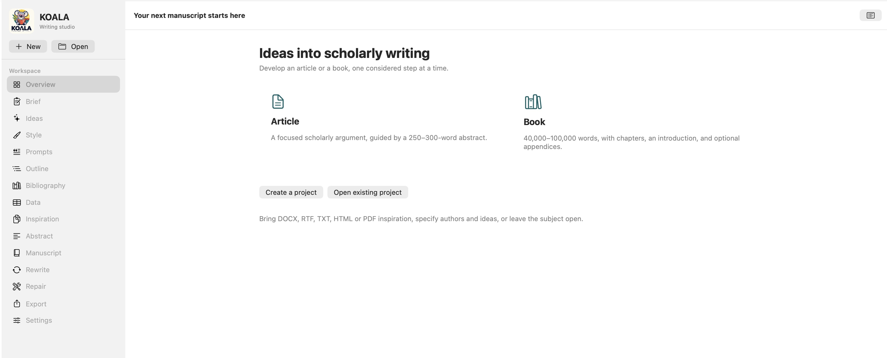
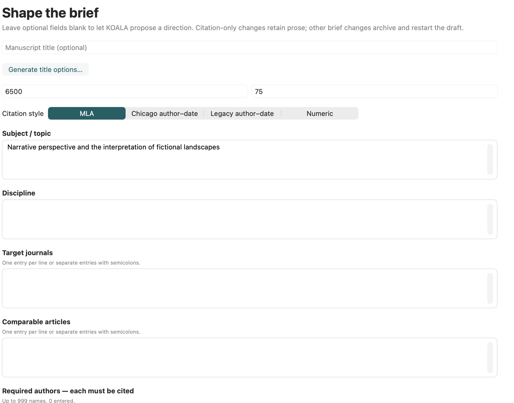
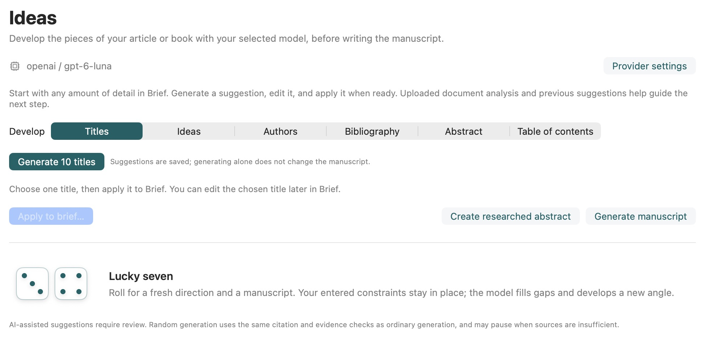
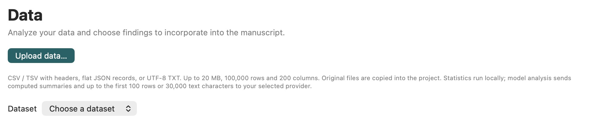

# KOALA: An Evidence-Aware Writing Studio for Scholarly Articles and Books

William Taggart  
Modern and Classical Languages and Literatures, Virginia Tech  
wtaggart@vt.edu

November 14, 2026

## Abstract

KOALA organizes scholarly writing as a persistent project spanning a brief, research, a guiding abstract, manuscript generation, revision, and export. A native macOS interface fronts a Python workflow with source ledgers, document and data imports, checkpoints, citation audits, and optional model-assisted interpretation. This report explains how evidence states and editable artifacts constrain generation, which decisions require user review, and why formal citation checks cannot establish scholarly validity. It documents the implemented workflow without claiming an evaluation of manuscript quality.

## Design motivation and related work

KOALA expands to Knowledge-Oriented Australian Literary Analysis. It supports humanities and social-science articles and books by retaining the artifacts that connect an initial idea to a draft: the brief, research sources, outline, abstract, data findings, and revision history. The user can develop a project incrementally rather than expressing every requirement in one prompt.

STORM separates research and outline construction from long-form writing [1], illustrating the importance of prewriting organization. ALCE evaluates the quality of citations in generated text independently of surface fluency [2]. FActScore decomposes long-form factuality into supported atomic claims [3]. Together these works help distinguish a useful writing workflow from a claim-verification system. KOALA implements structured evidence and audit mechanisms, but it does not implement those studies' complete evaluation procedures or inherit their measured results.

*Figure 1. The native macOS writing studio offers article and book project workflows.*

## Architecture and persistent projects

A SwiftUI macOS application invokes a Python workflow. The repository also exposes a command-line path. Native forms, dialogs, and project navigation manage local artifacts; remote language models perform inference through the selected OpenAI or Virginia Tech ARC connection. Literature-discovery services supply metadata and, when available, abstracts or fuller evidence. Local descriptive data analysis and export are separate from inference.

A project stores configuration and progress on disk. Article and book modes have different length and structural expectations: articles target 1,000 to 20,000 words, and books target 40,000 to 100,000. Books normally begin with an introduction and five to eight chapters, while imported outlines can extend that structure. These are requested targets, not guarantees of model output length. New, open, and recent-project actions support continuation; a confirmed deletion moves the project folder to macOS Trash.

## From a brief to a researchable plan

The brief supplies a topic, intended length, citation style, disciplinary orientation, audience, comparable works, required authors, and other guidance. Optional fields allow the user to choose how much direction to provide. MLA is the default citation style, with Chicago author-date and additional formatting options available. A style setting governs presentation rather than the validity of a reference.

*Figure 2. The brief defines topic, target length, citation style, required authors, and research guidance.*

The Ideas workspace can propose ten title choices, research ideas, authors, a starter bibliography, an abstract, and a table of contents. Suggestions are generated separately from applying them to the project. A user can therefore review an idea without immediately replacing the brief or manuscript. A guiding abstract of approximately 250 to 300 words precedes manuscript generation and anchors the subsequent plan.

*Figure 3. Ideas are generated separately from applying them to the brief or manuscript. This demonstration project has not generated prose.*

Writing-style inputs use broad craft characteristics. Custom prompts supplement the workflow but remain subject to evidence constraints. The distinction matters when a stylistic request would otherwise encourage invented quotations or unsupported certainty. The manuscript pipeline progresses through planning, research, and drafting, retaining checkpoints and incrementally saved chapters rather than treating a book as a single response.

## Source ledger and evidence boundaries

Research combines Crossref metadata and abstracts, Open Library edition metadata, and discovery routines for primary and secondary sources. Records receive source identifiers and are deduplicated. The ledger distinguishes metadata-only records, abstracts, fuller text, and secondary evidence. A required author is not considered directly evidenced simply because a secondary work mentions that author.

Generation must select known source identifiers; invented identifiers are rejected. Citation markers and locators are checked, and audits expose coverage and formatting problems. These checks establish traceability to a record. They cannot establish that a passage in the cited work entails the generated claim. Metadata alone is insufficient for a close reading, verbatim quotation, or precise page locator. The workflow explicitly distinguishes those evidence levels instead of silently treating every search result as full text.

Article targets of roughly 50 to 100 works and book targets of roughly 200 to 800 are planning goals. They must not be satisfied by padding a bibliography with invented references. Where research falls short, an authorized provisional draft can proceed using available evidence and an exposed shortfall. The resulting manuscript still requires source consultation and scholarly judgment.

## Imported documents and data

The Inspiration workflow accepts DOCX, PDF, RTF, TXT, and HTML. Long documents are analyzed in chunks, and completed analyses can be reused across projects. HTML scripts are removed; scanned PDFs require OCR before useful text analysis. Bibliography and outline imports can guide research and structure independently of the inspiration material.

*Figure 4. The data workspace states its local-analysis and provider-transmission boundaries.*

The Data workspace accepts CSV, TSV, flat JSON records, and TXT, with limits of 20 MB, 100,000 rows, and 200 columns. Local routines compute descriptive summaries, missingness, frequencies, and selected group comparisons. Model-assisted interpretation uses bounded material, including the first 100 rows or approximately 30,000 characters with summaries. That preview is not a randomized sample and may miss later patterns or rare cases. Users review findings and explicitly choose which to include in generation.

This separation makes the transmission boundary concrete: local statistics need not invoke a model, while model-assisted interpretation sends selected content to the configured provider. Credentials are supplied for the session; the application does not automatically load a project .env file. Local project persistence and provider processing remain distinct privacy considerations.

## Revision, audits, and export

Repair targets defects conservatively while preserving the current structure and evidence. Rewrite produces a separate candidate with backups and resumable progress, using revised parameters and existing evidence. These operations provide reviewable alternatives; they cannot guarantee perfect semantic preservation or factually correct prose. Before-and-after reports support inspection rather than replacing it.

*Figure 5. Export controls select document formats, abstract-only output, and optional audit gating.*

Exports include DOCX, HTML, TXT, RTF, and PDF, with an AI-assistance statement. Users can request abstract-only output and enable an audit requirement before export. Empty manuscripts are not exported as if they were completed work. The distinction between a successful file export and an academically defensible manuscript is retained: passing formatting or source-identifier checks does not validate interpretations, quotations, or causal claims.

## Implementation evidence and limitations

The captures show the native application with a demonstration project and no generated manuscript. No paid inference or newly measured writing-quality evaluation underlies these illustrations. The source includes tests and fixture-based checks of selected workflow components, but this report does not claim comprehensive testing of every provider, document type, or citation style.

The Python workflow requires Python 3.10 or later. Native source builds and packaged distributions can have different deployment targets; users should follow the requirements attached to the chosen release. Network access and authorized provider credentials are required for inference and online literature discovery. Model availability, service limits, and metadata coverage can change independently of the application.

The principal research limitation is the gap between structured evidence management and substantive scholarly verification. Future evaluation should measure source-claim support, quotation accuracy, revision faithfulness, recovered state after interruption, and author effort. Expert review is especially important for sparse research areas, non-English sources, and documents accessible only through metadata. The software organizes a drafting process; scholarly responsibility remains with the person developing and reviewing the work.

## AI disclosure

This project was created with assistance from GPT-6 Astra and Codex. AI tools assisted with implementation and with drafting, checking, and formatting this report. William Taggart directed the project. This disclosure does not imply independent human validation of every generated statement; the implementation and cited sources remain available for review.

## References

1. Yijia Shao, Yucheng Jiang, Theodore A. Kanell, Peter Xu, Omar Khattab, Monica S. Lam (2024). [Assisting in Writing Wikipedia-like Articles From Scratch with Large Language Models](https://arxiv.org/abs/2402.14207). arXiv:2402.14207.

2. Tianyu Gao, Howard Yen, Jiatong Yu, Danqi Chen (2023). [Enabling Large Language Models to Generate Text with Citations](https://aclanthology.org/2023.emnlp-main.398/). Proceedings of EMNLP; doi:10.18653/v1/2023.emnlp-main.398.

3. Sewon Min, Kalpesh Krishna, Xinxi Lyu, Mike Lewis, Wen-tau Yih, Pang Koh, Mohit Iyyer, Luke Zettlemoyer, Hannaneh Hajishirzi (2023). [FActScore: Fine-grained Atomic Evaluation of Factual Precision in Long Form Text Generation](https://aclanthology.org/2023.emnlp-main.741/). Proceedings of EMNLP; doi:10.18653/v1/2023.emnlp-main.741.

