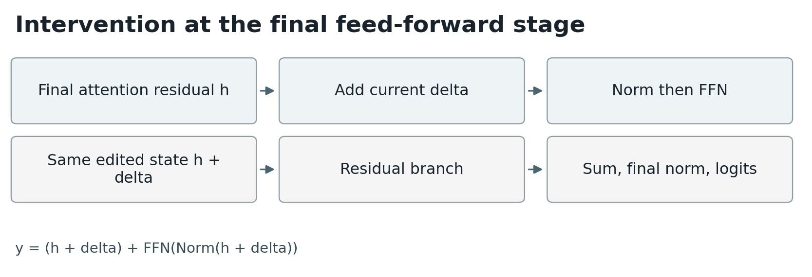
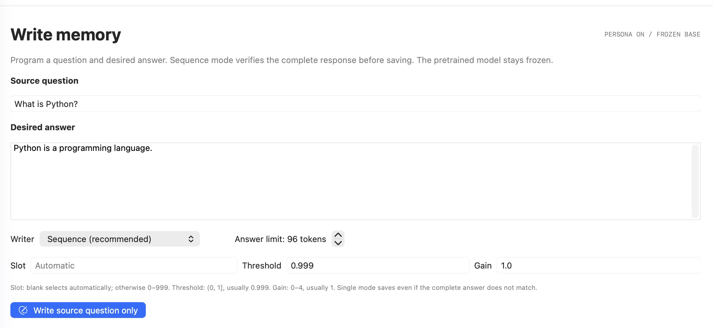

# LAMP-Qwen: Forward-Only Associative Memory for a Frozen Small Language Model

William Taggart  
Modern and Classical Languages and Literatures, Virginia Tech  
wtaggart@vt.edu

Report date: November 14, 2026

## Abstract

LAMP-Qwen extends Latent Associative Memory Programming (LAMP) from a small, one-word question–answer model to Qwen3.5-0.8B. A frozen pretrained transformer is augmented with editable numerical memory at the entrance to its final feed-forward network. A forward-only writer stores a normalized recognition key and differences between source and donor hidden states. A single stored adjustment changed responses but did not reproduce either of two initial target answers exactly. A sequence extension instead stores one adjustment per decoding step and reproduced all 12 selected target answers in a development pilot. Replacement, persistence, and clearing were also demonstrated; five unrelated questions retained their baseline answers, and hashes of the base model’s parameters were unchanged. These results establish a narrow implementation result: selected answers can be programmed through additional activation-steering tensors without gradient updates to the base model. They do not establish general semantic memory, reliable paraphrase recognition, or performance across the full 1,000-question catalogue. The implementation is available as a native macOS application and a command-line interface, both using the same local inference and memory-writing backend. This report describes the intervention, writer, computational costs, practical uses, and limits of the evidence, including a subsequent candidate-based recovery of a programmed association from an exported memory.

## Purpose and Research Context

LAMP-Qwen explores an editable numerical memory for a pretrained language model whose distributed parameters are otherwise difficult for a user to change directly. A user supplies a source question and a desired answer, then invokes an explicit writer. The resulting memory recognizes a question state and modifies the computation that generates its continuation. This extends the earlier LAMP educational implementation, which used a 77,568-parameter toy transformer, 16 memory slots, and one-word answers ([Taggart, 2026](https://github.com/FL2744/LAMP)), to a pretrained model that generates multiple tokens.

The design relates to several forms of associative computation. Modern Hopfield networks connect continuous retrieval with attention ([Ramsauer et al., 2020](https://arxiv.org/abs/2008.02217)), while analyses of transformer feed-forward layers describe native key-value associations learned during pretraining ([Geva et al., 2020](https://arxiv.org/abs/2012.14913)). Fast-weight programming also studies writable numerical state ([Schlag et al., 2021](https://arxiv.org/abs/2102.11174)). LAMP-Qwen supplies an external store of normalized keys and selected activation displacements, preserving the frozen backbone. Its slots are an explicit intervention mechanism rather than a direct account of the model's learned knowledge or a guarantee of associative-memory capacity.

*Native macOS chat workspace comparing base and memory-enabled responses in the displayed persona configuration. This interface example is not an accuracy benchmark.*

The distinction between training and writing is central to that scope. Qwen has already undergone substantial training; the present writer uses inference, tensor subtraction, normalization, and validation without backpropagation or optimizer steps. Knowledge editors can learn targeted parameter updates ([Cao et al., 2021](https://aclanthology.org/2021.emnlp-main.522/)), and MEMIT modifies transformer weights to edit multiple factual associations ([Meng et al., 2022](https://arxiv.org/abs/2210.07229)). LAMP-Qwen instead selects an eligible slot and changes the final pre-feed-forward residual state. The two-branch insertion in Figure 2 carries the same displacement into the normalized feed-forward input and residual path, making the added memory independently disableable.

*Figure 2. Two-branch intervention schematic. The same displacement enters the normalization input and the residual path; no later attention layer follows this insertion point.*

MEMORILLA offers a useful comparison with a different latent-memory architecture ([Fallahpour et al., 2026](https://arxiv.org/abs/2610.21375v3)). Its frozen encoder stores document embeddings, and a trained memory module conditions on a query to produce soft tokens in the language model's input space. Its supervised experiments use 16 memory tokens with Qwen3-8B; adding a document requires encoding rather than retraining the language model. LAMP-Qwen writes source-donor differences without training a memory module and intervenes near the end of the model instead of adding input tokens. Its sequence storage grows with answer length, while MEMORILLA's fixed token budget limits decoder context rather than the size of its embedding store.

These differences also determine what the demonstrations can establish. Ordinary inference continues the model's forward computation after a numerical intervention rather than retrieving and printing a stored answer string, but the sequence extension records a decoding-position-dependent trajectory for a particular answer. It is therefore restricted activation replay whose recognition, interference, and paraphrase transfer require testing. MEMORILLA addresses document recall and composition through eight benchmarks and an agent setting; this report presents a 12-question exact-source development pilot. The results do not support a comparative accuracy or latency claim. The contribution is an inspectable forward-only intervention, with the LAMP code under the MIT license and model and dependency licenses remaining separate.

## Native macOS application and local workflow

LAMP-Qwen provides a native SwiftUI macOS application alongside its command-line tools. The desktop workspace supports chat, base-versus-memory comparisons, memory writing, a searchable 1,000-question catalogue, slot controls, direct numerical editing, and memory import and export. The chat, writer, and persona screenshots in this report show the native application.

The interface exchanges JSON messages with a bundled Python worker over private standard-input and standard-output pipes. The worker uses the same inference engine and memory writer as the command-line implementation; the interface does not change the intervention algorithm. Operations run locally, with conflicting controls disabled while the worker is busy. No browser or web server is required.

The Apple Silicon distribution bundles Qwen3.5-0.8B, Python, and dependencies, requires macOS 26 or later, and is available from the [project repository on Hugging Face](https://huggingface.co/will-taggart/LAMP-Qwen-v0.1). No separate Python installation, Ollama service, or model download is needed. Memory persists in Application Support, separately from the app bundle and command-line memory; imports require compatible model and runtime settings. Questions are processed independently: the visible chat is not supplied as conversation history, and answers do not automatically become memories. The interface supports inspection and experimentation without extending the pilot's empirical claims.

## Model and intervention point

The implementation loads the official `Qwen/Qwen3.5-0.8B` checkpoint at a fixed revision:\
`2fc06364715b967f1860aea9cf38778875588b17`. Its text decoder has 24 layers, hidden width $d=1024$, feed-forward intermediate width 3,584, and an output vocabulary dimension of 248,320 [2](#ref-qwen). Its hybrid stack alternates groups of linear-attention layers with full-attention layers; the final decoder layer uses full attention.

Experiments use the text path of the conditional-generation model, float32 weights, eager attention, evaluation mode, and disabled parameter gradients. Generation is greedy, uses a cache, and disables the thinking mode through the chat template. The source prompt asks for a direct, concise answer in one or two sentences. Tests ran on an M4 Mac mini with 16 GB unified memory using PyTorch’s Metal backend. The recorded environment uses Python 3.14, PyTorch 2.15.0, and Transformers 5.22.2.

Although an Ollama installation motivated the project, this implementation runs through Transformers. The ordinary Ollama chat API does not provide the internal layer hooks used here [3](#ref-ollama). The existing quantized Ollama model is left unchanged; its results and resource requirements should not be conflated with those of this float32 implementation.

### Changing both the feed-forward input and its residual

Let $h_t\in\mathbb{R}^{1024}$ be the final decoder layer’s state after the attention residual at decoding step $t$. Without memory, the remaining block computes

$$
u_t=h_t+\mathrm{FFN}\!\left(\mathrm{RMSNorm}(h_t)\right).
$$

Memory supplies an adjustment $\delta_t$, producing

$$
u'_t=(h_t+\delta_t)+
\mathrm{FFN}\!\left(\mathrm{RMSNorm}(h_t+\delta_t)\right).
$$

The final model normalization and output head then produce vocabulary logits.

A pre-hook on the layer’s post-attention normalization adds $\delta_t$ to its input. A second hook adds the same adjustment to the layer output, accounting for the residual path. Modifying the normalization input alone would not implement Equation (2). During prompt processing only the final token state is edited. Cached generation then processes the newly generated position. No subsequent attention layer consumes the edited state.

Question tokens → pretrained decoder → $h_t$; then $h_t+\delta_t$ → final FFN and residual → final normalization → vocabulary logits.

### Recognition and routing

The memory has $S=1000$ slots. It stores a key matrix $K\in\mathbb{R}^{S\times d}$ and an adjustment matrix $D\in\mathbb{R}^{S\times d}$, initially zero. Each slot also has an enabled flag, a threshold, and a gain. For a source state $h_0$, writing sets

$$
K_i=\frac{h_0}{\lVert h_0\rVert_2},
\qquad
s_i=\left\langle\frac{\widetilde h_0}{\lVert\widetilde h_0\rVert_2},K_i\right\rangle .
$$

At inference, $\widetilde h_0$ is the current question state. The highest-scoring enabled slot at or above its threshold is selected, with a default threshold of 0.999. With unit keys, scores are cosine similarities, not probabilities. The numerical weight editor exposes recognition-key values for direct modification. Such edits change the matching weights and can break the unit-length assumption. Selection is made once and held for the answer. If no slot qualifies, the original computation is retained.

## The forward-only writer

### Single-adjustment mode

*Native macOS memory-writing form with a source question and desired answer entered; the write has not been submitted.*
The original LAMP mechanism stores a source-to-donor displacement. A donor state $h^\ast_0$ is obtained from a prompt that leads toward the desired answer. The writer records

$$
K_i=h_0/\lVert h_0\rVert_2,\qquad D_i=h^\ast_0-h_0.
$$

For the exact source state and unit gain, $h_0+D_i=h^\ast_0$: the remaining feed-forward network and output head receive the donor’s state. This identity applies to that position. It does not imply that the same adjustment will remain correct after new answer tokens are generated.

Single mode applies the same adjustment at every decoding step. In the initial two-question smoke test, it changed the generated responses but neither complete response matched its target. This motivated the sequence writer. The donor prompts also evolved during development, so these observations are not a controlled comparison isolating the effect of sequence memory.

### Sequence-adjustment mode

The default writer constructs a sequence $\Delta_i=(\delta_{i,0},\ldots,\delta_{i,L-1})$:

1.  **Generate a donor answer.** A separate prompt instructs the model to copy the desired answer verbatim, including all sentences and punctuation. The writer rejects unfinished generations or outputs that do not match the target after case and whitespace normalization.

2.  **Align the two trajectories.** Let $y_0,\ldots,y_{L-1}$ be the donor’s generated token sequence, including the stop token. Run the source-question prompt and donor-copy prompt with the same generated prefixes, using teacher forcing. Capture the pre-FFN state at each answer-prediction position.

3.  **Calculate the adjustments.** For each position, store
    $\delta_{i,t}=h^\ast_t-h_t$, for $t=0,\ldots,L-1$.
    The recognition key uses the source state before the first answer token. The writer also checks that the teacher-forced donor argmax tokens reproduce the donor generation.

4.  **Validate and commit.** Generate freely from the source question with the proposed memory. Save the entry only if the complete answer passes the same normalized-text comparison. Otherwise restore the previous memory.

At inference, the selected slot supplies the adjustment for the current decoding position, multiplied by its gain. After the stored trajectory ends, it supplies no further adjustment. The construction assumes the source question, prompting, model, and generation settings match those used when writing.

For an exact source and matching prefix, the source state plus its stored displacement equals the donor state. If this makes the next generated token match the donor, the shared-prefix condition can continue at the following step. Placing the intervention after the final attention operation helps: the edit does not directly alter future attention keys or values. Generated token identities still affect subsequent computation. Floating-point differences between teacher-forced and cached execution can also matter, which is why free-generation validation is required rather than relying on this argument alone.

### What is persisted

The safetensors file contains keys, adjustments, sequence trajectories, slot controls, and compatibility metadata. It does not contain per-entry question strings, answer strings, donor prompts, or token IDs. A fixed system prompt is part of the metadata. The separate question catalogue and diagnostic reports are authoring and evaluation resources; ordinary question inference does not use them as an answer database.

## Development evaluation

The source catalogue was imported from the workbook\
`chatbot-1000-questions-and-answers.xlsx`. It contains 1,000 questions in 25 categories, with 40 questions per category. It is a curated question bank, not a measured frequency ranking. Importing all entries does not establish successful writing of all entries.

The sequence pilot used 12 selected questions across 12 categories. Each successful write was checked by generating from its original question. Matching collapsed whitespace and ignored case; punctuation and substantive wording still had to agree. The donor instruction was refined using development cases, so this is not a held-out evaluation.

|  ID | Source question                  | Steps | Time (s) |
|----:|:---------------------------------|------:|---------:|
|   7 | What is a system prompt?         |    21 |    0.912 |
|  41 | How do I start an essay?         |    25 |    1.007 |
|  81 | What is a noun?                  |    27 |    1.077 |
| 121 | How do I study more effectively? |    26 |    1.036 |
| 161 | How do I calculate a percentage? |    34 |    1.355 |
| 201 | Why is the sky blue?             |    22 |    0.899 |
| 241 | What was the Renaissance?        |    28 |    1.145 |
| 281 | What are the seven continents?   |    32 |    1.265 |
| 321 | What is an operating system?     |    20 |    1.003 |
| 361 | What is Python?                  |    21 |    0.850 |
| 401 | What is HTML?                    |    25 |    0.995 |
| 441 | What is a spreadsheet formula?   |    23 |    0.916 |

Table 1. All 12 writes passed normalized full-answer matching at write time. Steps include the stop token; times cover steered generation, excluding loading and the full writing procedure.

The 12 trajectories contain 304 steps. Recorded generation times range from 0.850 to 1.355 seconds, with a median of approximately 1.005 seconds. These are local observations, not a controlled throughput benchmark. Entries were written into a growing memory, but the experiment did not exhaustively retest every previous entry after every later write.

### Replacement, isolation, and restoration

A replacement trial rewrote the Python answer to: *In this fictional setting, Python is a floating library above the clouds.* The new 17-step trajectory reproduced that sentence, including after saving and reloading. This demonstrates user-directed replacement rather than an assertion about Python.

Five other questions—about boiling water, writing a good prompt, black cats, Python exceptions, and watersheds—selected no slot and produced the same answers as the baseline. Clearing all memory restored the baseline response to the Python question. These controls test preservation of baseline behavior, not factual accuracy; five examples do not establish a general false-activation rate.

With blank memory, the smoke test recorded a maximum logit difference of zero. SHA-256 hashes over the base model’s named parameters also matched before and after validation. Six unit tests covered blank behavior, routing, equivalence of the two-hook intervention to the explicit equation, persistence checks, replacement and clearing, and sequence persistence.

### Recognition limits

An earlier two-entry sequence test used the paraphrase *Explain what a system prompt does.* Its score was approximately 0.9792, below the 0.999 threshold, so memory did not activate. A strict threshold helps avoid unrelated matches but can miss semantically similar wording. This pilot did not evaluate the remaining 988 catalogue entries, broad paraphrase coverage, multi-turn histories, or adversarial near-matches.

## Costs and limitations

For width $d=1024$, $S=1000$ slots, and float32 storage, the fixed matrices require

$$
2Sd(4\ \text{bytes})=8{,}192{,}000\ \text{bytes}=7.8125\ \text{MiB}.
$$

Each sequence step adds 4 KiB. The 304-step pilot adds 1.1875 MiB; 1,000 answers averaging 30 steps would add approximately 117.19 MiB, beyond the fixed matrices and controls. The first adjustment is also retained in $D$. This is larger than storing the answer text; no storage-compression advantage is claimed.

Recognition costs $O(Sd)$ per question and applying a selected adjustment costs $O(d)$ per token. Writing requires donor generation, two teacher-forced traces, consistency checks, baseline generation, and free-generation validation. Keys and single adjustments are non-trainable parameters; sequence trajectories are buffers. Both are separately persisted numerical memory, not modified base parameters.

Exact-source reproduction does not establish general reasoning, factuality, paraphrase recognition, or general reconstruction of earlier questions. Next experiments should use held-out questions, matched donor prompts for single/sequence comparisons, retention tests after all writes, and threshold/gain sweeps with hard negatives. Low-rank trajectory storage is a possible extension, not a demonstrated result.

## Practical utility, reversibility, and recoverability

### Uses and comparison with output controls

*Native macOS persona configuration interface for preparing a behavioral profile.*
The immediate practical uses are controlled answer overrides, swappable sets of associations, and educational experiments in which users inspect, replace, or disable numerical memories while retaining the same base model. Local personalization is plausible for selected associations, but automatic learning, conversational recall, and broad domain expertise have not been demonstrated. A useful next evaluation would compare LAMP with prompt instructions, retrieval, and answer replacement on identical edits, measuring exact answers, unseen paraphrases, related reasoning, unrelated questions, latency, and storage.

An output filter can replace a completed answer string; LAMP instead changes hidden states before token selection. Prompt instructions and constrained decoding provide other ways to control generation. All can yield the same visible answer, and semantic recognition is not unique to LAMP. For fixed question–answer replacement, a conventional lookup is simpler and may be more reliable. Sequence memory remains a model-dependent trajectory for a selected answer, not evidence of a general knowledge update. Its value beyond replacement depends on demonstrating useful generalization. Reusable steering of tone or explanation style is a possible extension, motivated by activation-engineering research [7](#ref-actadd), rather than an established capability of this writer.

### Reversible edits and deployment visibility

Memory-file replacement, slot disabling, and clearing make interventions reversible without restoring a modified base checkpoint. Reversibility here means restoring the base computation, not guaranteeing that its answers are correct. Sharing a memory requires compatible model, runtime, and prompting settings. Removing the writer alone preserves inference; removing the inference hooks disables the intervention. The present implementation uses additional tensors and hooks, not another transformer block. File or execution inspection can expose those additions, whereas an answer-only API does not reveal the selected slot or its score. API probing can reveal effects without establishing their internal cause.

### Recovering an association from an exported memory

Numerical storage is not encryption. In a subsequent exploratory test, an exported memory’s slot 6 contained a seven-step trajectory. Twenty questions were tried with that slot forcibly activated in an in-memory copy; the output for a Texas-capital question suggested *Fayetteville*. Fifty state-capital questions were then compared with the stored recognition key. *What is the capital of Arkansas?* obtained a cosine score reported as 1.000000. With the original slot controls restored, that question selected slot 6 normally and produced *Fayetteville.* The memory’s owner confirmed both the source question and the programmed answer. The supplied file was not modified.

This is one candidate-based recovery, not a blind inversion benchmark or proof that arbitrary questions are recoverable. The preliminary outputs guided the candidate family; a reported score of one alone would not prove unique recovery. The programmed answer was an intentional counterfactual. The result nevertheless shows that omitting per-entry text does not ensure confidentiality. The key, adjustment sequence, model, and runtime together can support probing. Embedding-inversion results [8](#ref-inversion) reinforce the need for testing, but their recovery rates cannot be transferred to these Qwen states. Exact wording, approximate meaning, and answer recovery should be evaluated separately; no recovery-time or success-rate estimate is established for unconstrained questions.

### Scaling limits

A million entries averaging 50 generation steps would occupy about 198.4 GiB in fixed and sequence tensors, excluding controls, the base model, and working space. The present implementation holds these tensors in RAM, scans all keys, and copies large arrays during writing. Indexed recognition and disk-backed trajectories could reduce RAM demand, but are unimplemented and would require latency and false-match evaluation. Neither storage efficiency nor reliable million-entry operation has been demonstrated.

## AI-use disclosure

This project was created with assistance from GPT-6 Astra and Codex. AI tools supported software development, technical exploration, and drafting and revision of the report. William Taggart is responsible for the research decisions and final software and documentation. AI assistance does not constitute independent validation of the implementation or its scientific claims.

## References

1. William Taggart. 2026. *LAMP: Latent Associative Memory Programming*. Software. [https://github.com/FL2744/LAMP](https://github.com/FL2744/LAMP).

2. Qwen Team. 2026. *Qwen3.5-0.8B: Model and configuration*. Model and configuration. [https://huggingface.co/Qwen/Qwen3.5-0.8B](https://huggingface.co/Qwen/Qwen3.5-0.8B).

3. Ollama. 2026. *Chat API documentation*. Accessed November 2026. [https://docs.ollama.com/api/chat](https://docs.ollama.com/api/chat).

4. A. Fallahpour and others. 2026. *Memorilla: Latent Semantic Memory for LLMs*. arXiv:2610.21375v3; project: https://memory.stanford.edu/. [https://arxiv.org/abs/2610.21375v3](https://arxiv.org/abs/2610.21375v3).

5. I. Schlag and K. Irie and J. Schmidhuber. 2021. *Linear Transformers Are Secretly Fast Weight Programmers*. ICML. [https://arxiv.org/abs/2102.11174](https://arxiv.org/abs/2102.11174).

6. N. De Cao and W. Aziz and I. Titov. 2021. *Editing Factual Knowledge in Language Models*. EMNLP. [https://aclanthology.org/2021.emnlp-main.522/](https://aclanthology.org/2021.emnlp-main.522/).

7. A. M. Turner and others. 2024. *Steering Language Models With Activation Engineering*. arXiv:2308.10248v5. [https://arxiv.org/abs/2308.10248v5](https://arxiv.org/abs/2308.10248v5).

8. J. Morris and V. Kuleshov and V. Shmatikov and A. Rush. 2023. *Text Embeddings Reveal (Almost) As Much As Text*. EMNLP. [https://aclanthology.org/2023.emnlp-main.765/](https://aclanthology.org/2023.emnlp-main.765/).
9. Ramsauer, Hubert, Schäfl, Bernhard, Lehner, Johannes, Seidl, Philipp, Widrich, Michael, Adler, Thomas, Gruber, Lukas, Holzleitner, Markus, Pavlović, Milena, Sandve, Geir Kjetil, Greiff, Victor, Kreil, David, Kopp, Michael, Klambauer, Günter, Brandstetter, Johannes, Hochreiter, Sepp (2020). [Hopfield Networks is All You Need](https://arxiv.org/abs/2008.02217). DOI: 10.48550/arXiv.2008.02217.

10. Geva, Mor, Schuster, Roei, Berant, Jonathan, Levy, Omer (2020). [Transformer Feed-Forward Layers Are Key-Value Memories](https://arxiv.org/abs/2012.14913). DOI: 10.48550/arXiv.2012.14913.

11. Meng, Kevin, Sharma, Arnab Sen, Andonian, Alex, Belinkov, Yonatan, Bau, David (2022). [Mass-Editing Memory in a Transformer](https://arxiv.org/abs/2210.07229). DOI: 10.48550/arXiv.2210.07229.

## Suggested citation

William Taggart. 2026. LAMP-Qwen: Forward-Only Associative Memory for a Frozen Small Language Model. Technical report. Modern and Classical Languages and Literatures, Virginia Tech. November 14, 2026. https://huggingface.co/will-taggart/LAMP-Qwen-v0.1
